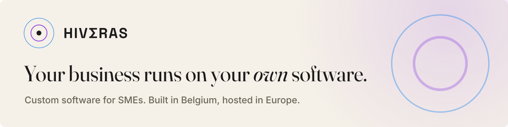
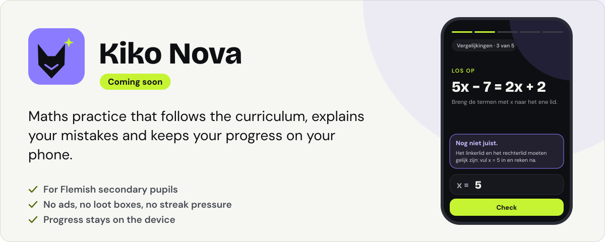

<picture>
  <source media="(prefers-color-scheme: dark)" srcset="assets/banner-dark.svg">
  <source media="(prefers-color-scheme: light)" srcset="assets/banner-light.svg">
  
</picture>

## Who we are

Hiveras is a small Belgian company. We build software for small and medium-sized businesses: automation and applications built around the way each company works. Where human judgement is needed, AI supports people and a person decides. Everything runs on a secure European platform.

## What we build

- **Your own software.** Applications that follow the way you work, instead of separate packages that do not talk to each other.
- **Automation first.** Work that is always done the same way runs predictably, every time.
- **AI that supports people.** AI reads along and prepares proposals. Nothing goes out without a person's approval.
- **Step by step.** Current tools keep running while the new software takes over.

More about our work for businesses: [hiveras.com](https://www.hiveras.com).

## Community projects

We are starting to share some of our work as open source, for and with the community.

<picture>
  <source media="(prefers-color-scheme: dark)" srcset="assets/kikonova/card-dark.svg">
  <source media="(prefers-color-scheme: light)" srcset="assets/kikonova/card-light.svg">
  
</picture>

### Kiko Nova

**Coming soon.** Maths practice that follows the curriculum, explains your mistakes and keeps your progress on your phone.

Kiko Nova is a practice app for pupils in Flemish secondary schools. It runs in the browser and installs like an app.

- **Follows the curriculum.** Exercises are generated per topic, so practice stays varied.
- **Explains wrong answers.** When an answer is wrong, the app names the likely mistake and shows the next step.
- **Fun without pressure.** It is gamified, with no ads, no loot boxes and no streak pressure.
- **Private by design.** Progress stays on the pupil's own device. Optional anonymous feedback goes to a service hosted in the EU.
- **Built with teachers.** Once the repository is public, teachers can propose exercises and report errors through GitHub issues. We review and test every change before it is released.

> **Leerkracht?** Je kan straks oefeningen voorstellen en fouten melden via GitHub, gewoon in het Nederlands.

### More to come

We will add new community projects here as they open up.

## How we work in the open

- **Privacy by design.** We collect as little as possible, and nothing that a project does not need.
- **Local-first where possible.** Data stays on your own device unless there is a clear reason to send it anywhere.
- **Hosted in the EU.** When a project needs a server, it runs in a European region.
- **Every change reviewed and tested.** No change is merged without an independent review and passing tests.
- **Issues welcome.** Questions, ideas and bug reports all start as an issue. Dutch or English, plain language is fine.

## Get involved

- **Open an issue** in the project repository. Read [how to contribute](https://github.com/hiveras/.github/blob/main/CONTRIBUTING.md) first.
- **Be kind.** All our spaces follow our [code of conduct](https://github.com/hiveras/.github/blob/main/CODE_OF_CONDUCT.md).
- **Found a security problem?** Please report it privately. See our [security policy](https://github.com/hiveras/.github/blob/main/SECURITY.md).
- **Contact us** at [hello@hiveras.com](mailto:hello@hiveras.com) or on [hiveras.com](https://www.hiveras.com). We are based in Belgium.
